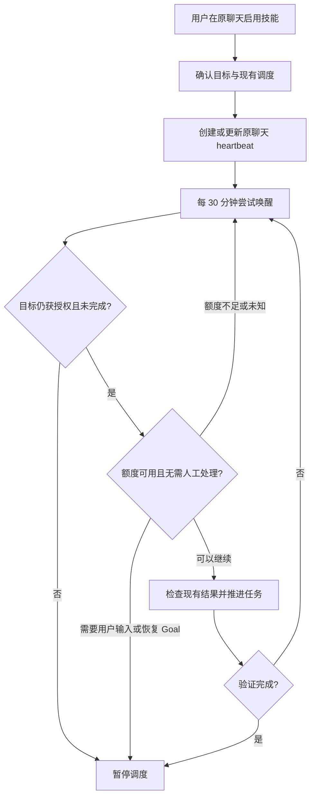

# Codex Auto Continue

[English](README.en.md) · [技能正文](skills/auto-continue/SKILL.md) · [验证记录](docs/validation.md)

**在原聊天中启用一次，让 Codex 定期回来继续未完成的任务。**

这是面向 Codex 桌面版的个人技能。它使用应用内置的定时任务，默认每 30 分钟尝试继续同一个聊天；任务完成、你取消或需要人工处理时暂停调度。无需第三方常驻服务。

> **v0.1.0 是实验版本。** 已在 Windows 桌面版验证原聊天定时唤醒、上下文保留和测试调度自动暂停。**尚未验证跨真实额度耗尽后的恢复，也不保证无人值守完成任务。** 技能和定时请求都受账户额度限制；请在额度耗尽前启用。

## 适用场景

- 长任务尚未完成，希望在暂时中断后定期回来继续。
- 希望沿用原聊天、已有文件和任务约束。
- 希望用原生调度管理续跑，不安装后台监控软件。

它不是额度绕过工具，也不能直接恢复暂停或预算受限的 `/goal`。**发送续跑消息与重新激活 Goal 状态是不同的动作。**

## 安装

需要带原聊天定时任务能力的 Codex 桌面版。当前聊天必须提供 `automation_update`、`get_usage_limits` 和必要的 Goal 状态检查工具；仅安装技能不会为 CLI、IDE 或其他客户端增加这些能力。运行下面的安装器需要 Python 3.10+，只使用标准库。

```powershell
git clone https://github.com/weilizhe8-del/codex-auto-continue.git
cd codex-auto-continue
python scripts/manage_skill.py install
```

安装位置为 `$CODEX_HOME/skills/auto-continue`；未设置 `CODEX_HOME` 时使用 `~/.codex/skills/auto-continue`。安装器拒绝覆盖已有目录，并拒绝符号链接或 junction 路径。

也可以手动把仓库中的 `skills/auto-continue` 文件夹复制到个人技能目录；如果已存在，请先备份并比较，不要直接覆盖个人修改。手动安装不需要 Python，但脚本卸载只支持由该脚本安装且未被修改的副本。

安装后在新一轮聊天中输入 `$auto-continue`，或在桌面版 `/` 菜单中搜索 `auto-continue`。若没有出现，重启应用再检查。

## 使用

**在需要续跑的任务聊天中调用**，不是在另一个空聊天中调用：

```text
$auto-continue
```

技能从上下文提取目标、完成标准和进度，检查额度，再创建绑定当前聊天的调度。没有明确目标时会先询问。安装成功不代表已启用；只有看到创建成功的调度卡片和启用说明，才算完成设置。

```text
$auto-continue 查看状态
$auto-continue 停止
```

也支持英文 `status` 和 `stop`。停止会暂停后续调度；不会杀掉已经运行的外部进程。重复启用同一个目标会复用原调度。默认不设到期时间，直到任务完成、取消或需要人工处理。

保持电脑唤醒、应用运行、项目目录可访问。恢复时间来自账户实际返回的信息；不是固定再等五小时。每 30 分钟调度也意味着它不保证在额度恢复的一瞬间开始。

## 工作方式



这是技能的决策流程，不是独立运行的后台程序。如果额度阻止了模型启动，当次技能逻辑不会执行；之后是否继续触发取决于应用调度器。应用关闭、休眠和额度失败后的补跑行为仍需验证。

## 已验证与未验证

| 能力 | 当前证据 |
| --- | --- |
| 技能格式与个人技能发现 | 本地校验通过，Codex 返回已启用的 user skill |
| 原聊天唤醒、保留上下文、暂停测试调度 | 2026-10-21 Windows 桌面版实测通过 |
| 安装、卸载及保护已有文件 | 可重复的 Python 自动化测试；跨平台结果见 Actions |
| 完整的默认 30 分钟多轮业务续跑 | 尚未端到端验证 |
| 跨真实五小时/周额度恢复 | 尚未验证 |
| 自动恢复暂停或预算受限的 Goal | 不支持 |
| 关闭应用、休眠、重启后的补跑 | 尚未验证 |

[验证记录](docs/validation.md)包含测试方法和限制。不要把安装器 CI 成功等同于 Codex 额度恢复成功。

## 更新与卸载

先在每个曾启用的聊天中运行 `$auto-continue 停止`，或在应用的定时任务界面暂停相关任务。**删除技能文件不会删除定时任务**，因为调度保存了自己的提示。

```powershell
python scripts/manage_skill.py uninstall
git pull --ff-only
python scripts/manage_skill.py install
```

只卸载时运行第一条即可。卸载器只删除它登记过且内容未变的文件；有个人修改、额外文件或缺少安装记录时会拒绝删除。请手动备份和处理这些情况。它不修改任何账户、项目、配置或已有调度。

可使用 `--codex-home <目录>` 在测试目录安装或卸载。路径不支持符号链接/junction；请使用实际目录。

## 开发与反馈

```powershell
python -m unittest discover -s tests -v
```

测试使用临时目录，不访问真实账户，不创建定时任务，也不消耗模型额度。提交问题时提供操作系统、Codex 版本、复现步骤和已脱敏的错误；不要上传认证文件、完整会话日志、聊天 ID 或个人项目路径。功能变更请同步技能正文与验证记录。

原生调度和技能入口参考：[Scheduled tasks](https://learn.chatgpt.com/docs/automations)、[Slash commands](https://learn.chatgpt.com/docs/reference/slash-commands)。具体可用性以你的应用和工具能力为准。

## 作者与许可

由 **[weilizhe8-del](https://github.com/weilizhe8-del)** 主导，使用 **OpenAI Codex** 协作完成设计、实现与验证记录整理。作者负责项目方向与发布；Codex 是开发辅助工具，不是独立维护者。

这是独立社区项目，与 OpenAI 无隶属或官方背书关系。代码和技能以 [MIT License](LICENSE) 发布。
